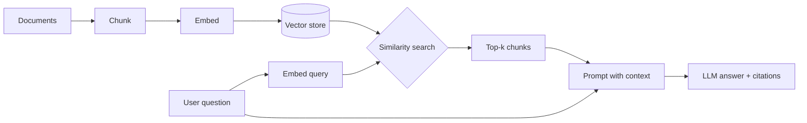

Large language models know a lot, but not *your* documents — and they will confidently invent an answer when they do not know. **Retrieval-Augmented Generation (RAG)** fixes both problems by retrieving relevant passages first and asking the model to answer *from those passages*. This note walks through each stage of a RAG pipeline and the decisions that actually determine quality.

## The pipeline at a glance



There are two phases: **indexing** (done once per document) and **querying** (done per question).

## 1. Chunking

Embedding models have input limits, and retrieval works best on focused passages. We split documents into chunks — typically 200–800 tokens with some overlap so a sentence is not cut away from its context.

```python
def chunk(text: str, size: int = 800, overlap: int = 120) -> list[str]:
    chunks, start = [], 0
    while start < len(text):
        end = min(len(text), start + size)
        chunks.append(text[start:end])
        if end == len(text):
            break
        start = end - overlap
    return chunks
```

> [!TIP]
> Split on structure when you can — headings, sections, list items. A requirements document chunked by requirement ID retrieves far better than one chunked every 800 characters.

## 2. Embeddings

An embedding model maps text to a vector $\mathbf{e} \in \mathbb{R}^d$ such that passages with similar meaning land close together. Similarity is usually measured with cosine similarity:

$$
\operatorname{sim}(\mathbf{q}, \mathbf{c}) = \frac{\mathbf{q} \cdot \mathbf{c}}{\lVert \mathbf{q} \rVert \lVert \mathbf{c} \rVert}.
$$

```python
from sentence_transformers import SentenceTransformer

model = SentenceTransformer("all-MiniLM-L6-v2")
vectors = model.encode(chunks, normalize_embeddings=True)  # unit length → dot = cosine
```

## 3. The vector store

A vector database such as ChromaDB stores each chunk's vector with its text and metadata (source, page, section) and answers nearest-neighbour queries quickly using approximate indexes.

```python
import chromadb

client = chromadb.PersistentClient(path="./index")
col = client.get_or_create_collection("srs")
col.add(ids=[f"c{i}" for i in range(len(chunks))], documents=chunks,
        embeddings=vectors.tolist(),
        metadatas=[{"source": "srs.pdf", "chunk": i} for i in range(len(chunks))])
```

## 4. Retrieval

At query time we embed the question with the same model and fetch the top-$k$ most similar chunks. Quality improvements usually come from here rather than from the LLM:

- **Hybrid search** — combine keyword (BM25) scores with vector scores to catch exact identifiers and rare terms.
- **Re-ranking** — retrieve 20–50 candidates cheaply, then re-score them with a cross-encoder and keep the best 5.
- **Metadata filters** — restrict to a product version, document type or date range.

## 5. Generation with grounding

The retrieved chunks are placed in the prompt with explicit instructions:

```text
Answer the question using ONLY the context below.
If the answer is not in the context, say "I don't know".
Cite the chunk ids you used, like [c12].

Context:
[c12] ...
[c31] ...

Question: ...
```

Asking for citations makes answers auditable and makes hallucinations easier to spot.

## Evaluating a RAG system

Measure the two halves separately:

| Stage | Question | Example metric |
| --- | --- | --- |
| Retrieval | Did we fetch the passages that contain the answer? | recall@k, MRR |
| Generation | Is the answer correct *and* supported by those passages? | faithfulness, answer accuracy |

Build a small evaluation set of real questions with known source passages before tuning anything — otherwise you are optimising by impression.

## Common failure modes

1. **The answer was never retrieved.** Fix chunking, add hybrid search or re-ranking.
2. **Too much irrelevant context.** Lower $k$ or re-rank; long noisy prompts degrade answers.
3. **Stale index.** Re-index when documents change, and store document versions in metadata.
4. **Prompt injection inside documents.** Treat retrieved text as data, never as instructions, and keep tool permissions minimal.

## Where this shows up

A test-case generator can use exactly this pipeline: index a Software Requirements Specification, retrieve the requirements relevant to a feature, and ask the model to produce structured test cases that cite the requirement they cover. Retrieval keeps the generation grounded in the actual specification rather than in what the model imagines a typical system does.
